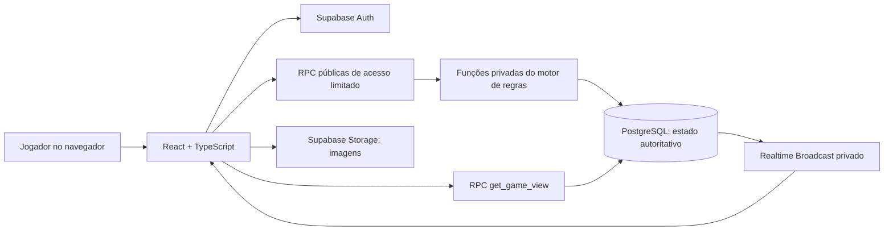

# BARALHO DA RESENHA
## Documento mestre de produto, regras e desenvolvimento — versão 1.1

**Referência de jogo:** Resenha Simples v7.1  
**Data:** 15/10/2026  
**Status:** especificação para desenvolvimento de MVP. A versão 1.1 incorpora `BARALHO_DA_RESENHA_DECISOES_APROVADAS.md` (itens A–F), que prevalece em caso de conflito. Balanceamento ainda depende de playtests.  
**Idioma:** pt-BR  
**Plataforma inicial:** web responsiva (desktop e celular).  
**Modelo de operação:** multiplayer online privado, com jogadores autenticados e salas de 3 a 8 pessoas.  
**Diretriz arquitetural:** **não criar backend Node/Nest/Express separado**. O Supabase concentra Auth, PostgreSQL, funções RPC, Realtime e Storage.

---

# 1. Resumo executivo

Criar um jogo online multiplayer de cartas com memes, fotos, apelidos e histórias dos amigos. A experiência deve ser simples de entender: **comprar cartas, usar até duas ações por turno, atacar/defender, sobreviver e vencer**. Jogadores derrotados tornam-se fantasmas e continuam interferindo na partida, podendo ressuscitar uma única vez.

O MVP terá:

1. Login privado por **usuário e senha**.
2. Lobby com criação/entrada em sala por código.
3. Mesa multiplayer sincronizada em tempo real.
4. Baralho principal com **160 cartas físicas virtuais** divididas entre 30 modelos.
5. Baralho do Além com **20 cartas** e 5 modelos.
6. Gestão automática de turnos, mãos privadas, danos, reações, curas, efeitos temporários, ressaca, fantasmas, ressurreições e vitória.
7. Visual personalizado por personagem, painel de regras, registro das jogadas e opção de revanche.
8. Administração simples de usuários, catálogo e imagens **fora do fluxo da partida**, inicialmente pelo painel Supabase/migrações.

**Fora do MVP:** pagamentos, ranking global, chat complexo, IA adversária, torneios, modo offline, suporte equilibrado a 9–15 pessoas, editor visual público de cartas, mobile nativo e partidas com espectadores.

## 1.1 Objetivos de qualidade

- Uma pessoa consegue aprender o básico em menos de 3 minutos.
- Jogadores não conseguem espiar mãos/decks alheios nem alterar vida/turno via DevTools.
- Uma ação é aplicada **uma vez**, mesmo com clique repetido ou duas abas abertas.
- Atualizações chegam aos demais clientes sem refresh manual.
- Recarregar a página restaura fielmente o estado autorizado da partida.
- Interface totalmente utilizável no celular.
- Cartas e regras são legíveis, sem necessidade de decorar poderes.

---

# 2. Tecnologias e justificativas

| Camada | Tecnologia | Responsabilidade |
|---|---|---|
| Aplicação | React + TypeScript + Vite | SPA e desenvolvimento rápido |
| UI | Tailwind CSS v4 + shadcn/ui + Radix UI | Componentes acessíveis, modais, diálogos, menus e formulários |
| Ícones | lucide-react | Ícones consistentes |
| Navegação | React Router | Login, lobby, sala, partida, resultado |
| Dados assíncronos | @tanstack/react-query | Carregamento, invalidação e reconexão |
| Estado efêmero | Zustand **opcional** | Somente seleção de cartas, modais e preferências locais; nunca estado oficial |
| Formulários | React Hook Form + Zod | Validação de login e ações de interface |
| Auth | Supabase Auth | Sessões e senhas protegidas |
| Persistência e regras | Supabase PostgreSQL + funções SQL/PLpgSQL (RPC) | Fonte única da verdade, transações, sorteio e validação de jogadas |
| Tempo real | Supabase Realtime Broadcast (canais privados) | Avisos de atualização de uma partida |
| Arquivos | Supabase Storage | Fotos, capas e ilustrações |
| Testes web | Vitest + Testing Library | UI e regras auxiliares de apresentação |
| Testes SQL/segurança | pgTAP + Supabase CLI | RPC, políticas, permissões, concorrência e invariantes |
| Testes ponta a ponta | Playwright | Fluxos com múltiplos usuários |
| Qualidade | ESLint + Prettier + TypeScript strict | Padronização e prevenção de erros |
| Publicação | Vercel (ou Cloudflare Pages) | Hospedagem estática da SPA |
| Versionamento | Git/GitHub | Migrações, releases e histórico |

**Decisão importante:** o Supabase **já executa código de servidor** via funções Postgres. Não haverá aplicação backend separada, mas haverá **lógica de negócio confiável no banco**. A lógica principal nunca deve depender de cálculos enviados pelo navegador.

**Supabase Edge Functions:** **não necessárias para o MVP**. Usar apenas se surgir uma exigência externa real, como integração com e-mails administrativos, cron sofisticado ou processamento avançado de mídia. Não criar Edge Function para toda jogada se uma RPC transacional resolver.

**Instalação:** seguir as instruções atuais do shadcn/ui para Vite, já adaptadas a Tailwind v4. Não prender dependências a versões fictícias; gerar o lockfile e validar versões no momento da implementação.

---

# 3. Público, papéis e permissões

## 3.1 Papéis

- **Administrador da aplicação:** provisiona jogadores, gerencia acesso, publica catálogo e imagens. Não possui poderes especiais durante uma partida em andamento.
- **Host da sala:** cria sala, recebe código, pode **gerar um código novo** (o anterior para de funcionar), remover jogadores **no lobby** (quem é removido só volta se o host liberar), iniciar jogo com 3–8 pessoas e solicitar nova partida após término. Durante a partida **não expulsa jogador conectado**; só pode pedir a remoção de quem está **sem conexão confirmada há mais de 2 minutos** (seção 5.10). Se sair do lobby, o posto passa ao **participante conectado mais antigo** (ordem de ingresso como desempate).
- **Jogador:** entra no lobby, vê o estado público, sua própria mão, joga no seu turno e responde às reações.
- **Fantasma:** é um jogador derrotado, continua na mesma sala, mas usa somente cartas do Além.

MVP sem espectador. Membro da sala não pode ver a mão ou a ordem do baralho, mesmo que seja o host.

## 3.2 Login por usuário e senha: decisão concreta

**Limitação oficial:** o Supabase Auth usa senha com **e-mail ou telefone**. Não possui autenticação nativa diretamente por nome de usuário.

**Solução proposta para grupo privado:**

1. Cadastro **fechado**; contas criadas antecipadamente pelo administrador usando ferramentas administrativas seguras do Supabase.
2. Cada jogador recebe um `username` imutável, único, normalizado (minúsculas, sem espaços e sem acentos).
3. Internamente, esse username corresponde a um e-mail técnico sob **domínio controlado pelo projeto** (por exemplo, `leo@contas.seudominio.com`). O aplicativo apresenta somente os campos **Usuário** e **Senha**.
4. No login, o frontend converte o username para o identificador interno previsível e usa `supabase.auth.signInWithPassword({ email, password })`.
5. Não há tela pública de cadastro. Se as contas técnicas não receberem e-mail de verdade, **recuperação de senha por e-mail não estará disponível**; recuperação será manual pelo administrador, com procedimento seguro. Verificar o fluxo de confirmação na configuração do projeto.
6. O email técnico serve **apenas como identificador de Auth**, nunca como autorização para entrar em salas.
7. `public_username`, `display_name`, `avatar_path` e permissões ficam em perfis, relacionados ao `auth.users.id`; nenhuma senha fica em tabelas do jogo.

**Alternativa mais segura para longo prazo:** usuários usam e-mail real/senha por trás de uma interface que mostra “Usuário (e-mail)”; habilita recuperação de acesso sem criação de infraestrutura própria. Se o domínio controlado não existir, **não usar endereços fictícios de terceiros**.

**Não fazer:** tabela própria de senhas; comparação de hash feita no React; chave secreta/service_role no Vite; função RPC que informa e-mails associados a nomes publicamente; cadastro aberto sem necessidade.

---

# 4. Escopo funcional / telas

## 4.1 Rotas previstas

| Rota | Tela | Funções |
|---|---|---|
| `/login` | Login | Usuário/senha, erros, mostrar senha |
| `/lobby` | Início | Nome/avatar, criar sala, entrar por código, sair |
| `/sala/:id` | Sala de espera | Lista de participantes, pronto, código, iniciar, sair |
| `/jogo/:id` | Mesa | Jogadores/PV, mão, cartas, turno, reações, histórico, ressaca |
| `/resultado/:id` | Resultado | Vencedor, razão, estatísticas, revanche, voltar |
| `/regras` | Manual | Regras curtas e catálogo ilustrado |
| `/perfil` | Perfil | Apelido, avatar, preferências de animação/som |
| `/admin` | Opcional futuro | Gerenciamento visual de contas e artes, fora do MVP |

**Acesso:** rotas protegidas por sessão; banco valida associação à sala em cada operação. Guardas no React servem à experiência, **não substituem autorização no banco**.

## 4.2 Telas de produto

**Login:** card central, fundo temático, inputs simples, estados de erro e loading. Sem link de registro público.

**Lobby:** botão destacado “Criar resenha”, campo “Código da sala”, lista de partidas que o usuário pode retomar.

**Sala de espera:** cadeiras 1–8, quem entrou, host, código de **10 caracteres** para compartilhar (com link de convite), botão para o host gerar código novo, lista de removidos com "Permitir volta" (só o host vê), botão de pronto **apenas informativo**; somente host inicia com 3–8. A ordem das cadeiras no lobby é a de entrada; **os lugares da partida são sorteados ao iniciar**.

**Mesa desktop:** jogadores no topo/laterais; pilhas de baralho/descarte e efeitos no centro; mão do usuário na parte inferior; lateral de histórico e regras rápidas.

**Mesa mobile:** barra superior com rodada, turno e menu; lista compacta de oponentes em rolagem horizontal; carta em foco no centro; mão horizontal inferior; botão fixo “Jogar carta”; painel de reação em modal de prioridade alta.

**Fim:** vencedor, situação final, eliminações registradas automaticamente, opção de revanche (nova partida e embaralhamento) e retorno ao lobby.

## 4.3 Princípios de UX

- Destaque sempre **de quem é a vez** e **o que está aguardando resposta**.
- Apresentar PV atual/máximo e variação de dano/cura em animação curta.
- Clique na carta abre descrição completa; jogar requer alvo e confirmação quando pertinente.
- Jogada ilegal gera mensagem humana (“Você precisa descartar mais uma carta”).
- Botões impossíveis desabilitados, mas **servidor também valida**.
- Reações não dependem de cronômetro no MVP: jogador escolhe **Reagir** ou **Aceitar**. Isso evita turnos serem pulados injustamente por conexão lenta. **Limitação aceita:** um jogador conectado e inativo não é tratado automaticamente; o grupo pede que ele jogue ou o host encerra a partida.
- Cartas na mão aparecem na **ordem de recebimento**, com IDs de instância estáveis após reload; reorganizar arrastando fica para versão futura.
- Acessibilidade: contraste, textos alternativos para ilustrações, navegação por teclado, modos com animações reduzidas.
- Antes de usar fotos reais, obter concordância do grupo; preferir armazenamento privado.

---

# 5. Regras oficiais implementáveis — Resenha Simples v7.1

> Esta seção fixa decisões necessárias para codificar regras antes ambíguas. Mudanças depois de publicadas devem gerar versão explícita de regras e testes de regressão.

## 5.1 Preparação e rodada

- Jogadores: **3–8**; ordem fixa de assentos, sentido horário.
- **Lugares sorteados no banco ao iniciar a partida** (uma única vez, na mesma transação que cria as cartas); a ordem de entrada na sala não importa. Reload não muda os lugares.
- **O ocupante do lugar 1 começa a rodada 1.**
- PV inicial/máximo: **3 jogadores = 16; 4–5 = 18; 6–8 = 16**.
- Cada um inicia com **5 cartas** do baralho principal embaralhado.
- No começo de cada turno de jogador **vivo**, compra **2 cartas** — **inclusive o primeiro jogador na rodada 1** (pode ficar com 7 antes de agir).
- Executa **até 2 ações** voluntárias por turno; pode encerrar antes.
- Limite **7 cartas ao encerrar o próprio turno**; descarta excedentes escolhidos pelo usuário.
- Defesas e outras reações são jogadas quando solicitadas, fora do próprio turno; não consomem ação.
- Uma rodada é concluída após o último assento (vivo ou fantasma) executar seu turno; ao fim aplica-se dano ambiental, recalcula-se situação e avança-se de rodada.
- Limite máximo de **10 rodadas completas**.
- Vida jamais ultrapassa o máximo inicial; excedente de cura é desperdiçado.
- Carta sem alvo elegível não pode ser usada, salvo ajuste específico abaixo.

## 5.2 Categorias de cartas

- **Ataque:** causa dano a oponentes vivos.
- **Defesa:** reação a ataque contra si próprio, salvo descrição explícita.
- **Sabotagem:** altera mão/cartas/efeitos de adversários vivos.
- **Caos:** ação global ou dano especial sem classificação “ataque”.
- **Recuperação:** cura jogador vivo que a utiliza.
- **Reviravolta:** pode ser ação ou reação, de acordo com o modelo.
- **Além:** pode ser usada por fantasmas no turno de fantasma.

Cartas de defesa só podem ser usadas no momento apropriado. Ao jogar carta que pede descartar outra como **custo**, primeiro reservar e consumir a carta-custo (não pode ser ela mesma), **depois** iniciar a resolução; ação inválida não consome nada.

## 5.3 Mais Odiado

- No **início** de cada rodada, entre os vivos, quem tem o **maior PV** recebe o marcador.
- Se houver empate no maior PV, **ninguém é Mais Odiado** naquela rodada.
- Cada **ataque** contra o Mais Odiado causa **+1 dano por alvo**; caos, reação e Ressaca não recebem esse bônus.
- O marcador não é transferido durante a rodada. Se o marcado morrer, o bônus não passa a outro até a rodada seguinte.
- `Família Basilato` **não depende desse marcador**: escolhe adversário vivo com mais PV no instante da ação (empate: autor escolhe).

## 5.4 Reações (obrigatório implementar como fase de jogo)

**Não causar dano imediatamente após o atacante clicar.** Primeiro abrir uma janela de resposta aos afetados.

1. Jogador ativo envia ação/alvos.
2. O banco valida o estado, paga custos e cria `pending_action` com efeito base e destinatários.
3. Cada destinatário afetado pode usar **uma** reação elegível **ou passar**. O botão deve sempre permitir passar, para não revelar se há cartas defensivas na mão.
4. Em ação com dois alvos, as respostas são recebidas independentemente; o efeito só conclui quando todos responderem.
5. Ao finalizar as respostas, a RPC calcula modificadores, dano, curas, descarte, mortes, recompra e histórico **em uma transação**.
6. Não existem cadeias recursivas de `Reverso do Reverso`. Se um ataque individual é redirecionado ao autor, ele pode fazer **uma contradefesa simples** (`It's Not Amazing`, `Inimiga do Banho`, `Eu Tava Dormindo`, `Último do After` ou passar). Não pode redirecionar novamente. Se isso exigir complexidade excessiva na primeira sprint, deixar esse caso para teste obrigatório, não remover silenciosamente a regra.
7. Uma mesma pessoa não pode reagir duas vezes à mesma ação, exceto a contradefesa do novo alvo prevista acima.
8. Jogadas ambientais não abrem janela de reação.
9. Reação fatal (`Ressuscitou o Tio Paulo`) e `Última Palavra` disputam a única reação elegível ao golpe final: o jogador escolhe uma, não as duas.
10. **Cada jogador afetado usa no máximo uma reação por ação.** `Ressuscitou o Tio Paulo` é sobrevivência preventiva (fica com 1 PV, sem registrar eliminação); `Última Palavra` acontece ao ser eliminado por **outro jogador**, não impede a morte e o dano de 2 pode causar nova eliminação. Registrar a origem de cada dano e resolver em ordem determinística.
11. **Dano ambiental da Ressaca não permite** `Ressuscitou o Tio Paulo` nem `Última Palavra`.

**Sabotagens direcionadas** podem ser canceladas por `Evento Raro`; ações globais e caos não são sabotagens direcionadas. **`Evento Raro` não cancela `Lucboy & Laragirl` (REV-02, categoria Reviravolta) nem cartas do Além** (não são Sabotagem). No caso de efeitos que envolvam sorteio/troca da mão, aguardar defesa antes de efetuar o sorteio de carta.

## 5.5 Prioridade de resolução

- Validar autor, turno, alvo, disponibilidade da carta e custos.
- Fixar alvos, efeitos-base, buffs ativos e contexto do Mais Odiado no momento da ação.
- Coletar defesas/cancelamentos.
- Resolver o dano efetivo com piso **0**; aplicar a cura respeitando teto de PV.
- Resolver efeitos secundários de compra/descarte/troca.
- Identificar PV <= 0 e disparar reações de dano fatal já escolhidas.
- Executar efeitos retaliatórios (`Última Palavra`) e contabilizar derrotas com autoria válida.
- Transicionar mortos para fantasma e descartar suas cartas principais.
- Atualizar versão do estado e escrever evento público seguro.

**Simultaneidade:** `Fofoca Mortal` aplica danos aos dois alvos num mesmo lote após receber as respostas. Se várias pessoas forem derrotadas pelo mesmo lote, registrar o mesmo grupo de resolução; as derrotas são simultâneas para critérios de empate. Retaliação da `Última Palavra` permanece atribuída ao autor da reação.

**Dano próprio** de `A Braba` é um custo/efeito colateral da ação (não é um ataque contra si) e **não pode ser bloqueado com defesas normais**. Resolver o ataque ao alvo e as reações dele **antes** de aplicar o dano próprio ao autor. Se o dano próprio for fatal, o autor **pode usar `Ressuscitou o Tio Paulo`**; `Última Palavra` **não** ativa (não houve eliminação por outro jogador).

**Morte no próprio turno:** o turno termina imediatamente e as ações não usadas são perdidas. O primeiro turno de fantasma ocorre na rodada seguinte.

## 5.6 Cartas especiais / casos limite

- `Fofoca Mortal`: 2 PV a **dois adversários vivos diferentes**; se houver somente **um** outro vivo, causa **2 a esse único adversário** (não duplica o dano). Sem adversários vivos, não pode ser jogada.
- `Print Comprometedor`: escolher adversário com mais cartas **entre os oponentes vivos**; empate decidido pelo autor.
- `Anota na Conta da Tuca`: contra mão vazia, efeito não faz nada; recomenda-se desabilitar alvo vazio para não desperdiçar ação acidentalmente.
- `Plano Dental Negado`: alvo escolhe quais até 2 cartas descartar; se tiver 1, descarta 1; se tiver 0, descarta 0. “Até 2” não significa que ele pode deliberadamente descartar zero quando tem cartas: o número é `min(2, tamanho da mão)`.
- `Eu Amo Mentir`: exige ao menos 1 carta **extra** do autor na mão após baixar a carta de efeito e 1 carta com o alvo; trocar simultaneamente, com seleção de carta própria e seleção aleatória da alheia.
- `Tio Paulo`: cada vivo com mão não vazia escolhe 1 carta; somente os participantes que têm carta entregam 1 ao **próximo vivo à direita**; entregar simultaneamente para evitar que alguém repasse carta recém-recebida. Se houver menos de 2 vivos com carta, efeito sem troca.
- `Bucetada`: cada vivo descarta uma carta **à própria escolha**, se possuir.
- `O Acre Existe!`: todos os vivos compram 1 e escolhem 1 para descartar. As escolhas são privadas, a resolução da troca só termina após todos responderem.
- `Família Basilato`: é dano de **caos**, e não recebe bônus de Mais Odiado. Alvo é o **oponente** vivo de maior PV; não exige existir líder único. **Não admite defesa comum**, mas, se o dano for fatal, a vítima pode usar **uma** reação de dano fatal: `Ressuscitou o Tio Paulo` (fica com 1 PV) **ou** `Última Palavra` (morre e causa 2 ao autor).
- `Tem Alguém Seguindo`: marca o alvo; o **próximo ataque anunciado contra ele** recebe +2 e consome a marca, mesmo que depois seja defendido; expira **ao final da rodada seguinte à aplicação**. Marcas iguais não acumulam; nova marca apenas substitui/renova.
- `Maldição da Ressaca`: próxima tentativa de ataque contra o Mais Odiado atual recebe +1, consumindo o efeito ao anúncio válido do ataque. Se não houver Mais Odiado, o efeito fica pendente até surgir alvo, com validade **até o fim da rodada seguinte**; não acumula.
- `Lucboy & Laragirl`: troca **mãos restantes** entre autor e adversário vivo; a própria carta jogada já saiu da mão. Pode ocorrer com uma mão vazia.
- `Ressuscitou o Tio Paulo`: preserva 1 PV em vez de entrar em estado fantasma; **não gasta** a ressurreição do fantasma, não funciona contra Ressaca e não é cura acima de PV máximo.
- `Última Palavra`: ao sofrer derrota causada por carta de outro jogador, retalia com 2 PV ao responsável (mesmo que isso também o elimine). Não ativa em morte por Ressaca.
- Toda compra com baralho vazio reembaralha sua **própria pilha de descartes** dentro da transação. Não misturar baralho principal e Além.
- Sem cartas suficientes após reciclagem, compra somente o que existir; nenhuma carta nova é criada.

## 5.7 Fantasmas

- Ao ficar com 0 PV, mudar para `ghost`, zerar PV e enviar todas as cartas de mão principal ao descarte principal.
- O jogador mantém seu assento e continua participando de cada rodada.
- Em seu turno de fantasma, recebe **1 Ficha de Ressaca** enquanto ainda não tiver ressuscitado.
- Se agora possuir 3 fichas, pode **ressuscitar imediatamente nesse turno**, gastando 3 fichas. Se escolher ressuscitar, encerra o turno sem carta do Além.
- Se não ressuscitar: compra 1 carta do Além, pode jogar até 1 carta do Além e deve encerrar com no máximo 3 na mão do Além.
- Ressuscita com **6 PV e 3 cartas principais**, sem carregar cartas do Além; marcador `revival_used=true`.
- Após nova morte, continua fantasma, mas **não recebe mais fichas de retorno** nem pode ressuscitar.
- Fantasmas não são alvos de ataques normais, sabotagens contra vivos, cura normal ou Ressaca.
- Fantasma sem alvo elegível pode passar; se o Baralho do Além esgotar, reciclar seu descarte.
- Se um fantasma tem direito e fichas insuficientes para ressuscitar, permanece em jogo sem prazo extra além da rodada 10.

## 5.8 Ressaca Progressiva

| Rodada | Dano ambiental ao encerrar rodada |
|---|---:|
| 1–4 | 0 |
| 5–6 | 1 |
| 7–8 | 2 |
| 9–10 | 3 |

Dano simultâneo para todos os vivos. Não pode ser defendido, redirecionado nem atribuível a outro jogador; não conta como eliminação para desempate. Regra especial para derrotas simultâneas no encerramento disponível abaixo.

## 5.9 Fim de partida / desempate

**Condição principal:** último jogador vivo, desde que **nenhum fantasma consiga ressuscitar até o final da rodada 10**. Implementar verificação determinística dos turnos restantes, fichas e `revival_used`; não apenas `alive_count === 1`.

**Se chegar ao fim da rodada 10:**

1. Se há jogadores vivos: vence quem tem mais PV.
2. Empate de PV: maior número de eliminações **atribuídas a cartas daquele jogador**, contadas automaticamente.
3. Empate persistente: vitória compartilhada.
4. Se **todos estiverem mortos**: vence quem tiver sobrevivido até a fase de resolução mais tardia; se os últimos caíram em um mesmo lote, considerar a maior quantidade de PV **imediatamente antes do dano fatal daquele lote**; novo empate por eliminações e, persistindo, vitória compartilhada.

**Cuidado com regra de todos mortos antes da rodada 10:** se um fantasma ainda conseguir ressuscitar até o final da rodada 10, continuar a rotação dos turnos de fantasmas; caso contrário, aplicar critério acima e encerrar. Não criar vencedor arbitrário pelo último clique ou ordem técnica de UPDATE SQL.

**Nota de design:** dez rodadas e Ressaca intensa são parâmetros **experimentais**: testar se há excesso de mortes simultâneas ou partidas longas, antes de congelar balanceamento.

## 5.10 Desconexão / inatividade

MVP **sem eliminação automática por desconexão**; estado fica persistido. Fechar a aba, perder internet ou recarregar **não é desistência**: o jogador pode voltar com a mesma conta. A mesa apresenta aviso “Aguardando resposta de X”.

- **Presença registrada pelo servidor:** cada tela aberta envia um sinal (`heartbeat`) periódico; o horário é o do banco. "Conectado" = sinal nos últimos 60 s.
- **Remoção por ausência (manual):** depois de **mais de 2 minutos sem sinal**, o host **pode pedir** a remoção, com confirmação, motivo e autoria registrados. A RPC valida autoridade do host, ausência do alvo e o período de tolerância.
- O removido vira **desistente** (não fantasma): sem ressurreição, sem voltar à mesma partida e fora da disputa pela vitória; suas cartas vão para o descarte de forma consistente.
- Se houver ação pendente aguardando o removido, ela se resolve de forma determinística (como "passar") na mesma transação, para a partida nunca travar.
- Host **não expulsa jogador conectado** durante a partida. Perda temporária de conexão do host **não transfere o posto** na hora; sucessão durante a partida só por regra segura do servidor, transacional e sem ampliar acesso a cartas privadas.
- O host continua podendo **encerrar a sala inteira** com confirmação caso o jogo trave (não ganhar artificialmente por abandono).

**Versão futura:** timer autoritativo com expiração resolvida no servidor, e nunca por relógio do navegador; exigiria job/Supabase Cron ou processo equivalente, desenhado separadamente.

---

# 6. Catálogo completo de cartas (seed do banco)

## 6.1 Baralho principal — 160 instâncias / 30 modelos

| ID | Categoria | Nome | Personagem | Qtde | Efeito para apresentação |
|---|---|---|---|---:|---|
| ATK-01 | ataque | Falou Merda | Ryane | 10 | 3 de dano a adversário |
| ATK-02 | ataque | Não Vou Levar Numa Boa | Ana Vi | 6 | 3 de dano a adversário |
| ATK-03 | ataque | Peneira Suprema | Artur | 8 | 5 de dano; descartar outra carta como custo |
| ATK-04 | ataque | Fofoca Mortal | Lara | 8 | 2 de dano a até 2 adversários distintos |
| ATK-05 | ataque | Print Comprometedor | Léo | 6 | 4 de dano ao adversário com mais cartas |
| ATK-06 | ataque | Lor! | Adeir | 6 | 2 de dano; comprar 1 carta |
| ATK-07 | ataque | A Braba | Estefânia | 6 | 4 de dano ao alvo; 1 de dano próprio |
| DEF-01 | defesa | It's Not Amazing | Victor | 8 | Anula dano de 1 ataque recebido |
| DEF-02 | defesa | Inimiga do Banho | Manu | 6 | Reduz em 3 o dano de 1 ataque |
| DEF-03 | defesa | Eu Tava Dormindo | Ana Vi | 4 | Reduz em 3 o dano de 1 ataque |
| DEF-04 | defesa | Reverso do Reverso | Léo | 4 | Redireciona ataque individual ao autor |
| DEF-05 | defesa | Evento Raro | Davi | 8 | Anula sabotagem direcionada |
| DEF-06 | defesa | Último do After | Cadu | 6 | Reduz 2 do ataque e compra 1 carta |
| SAB-01 | sabotagem | Anota na Conta da Tuca | Cadu | 8 | Rouba 1 carta aleatória |
| SAB-02 | sabotagem | Terapia de Boteco | Lara | 4 | Vê mão adversária e escolhe 1 descarte |
| SAB-03 | sabotagem | Tem Alguém Seguindo | Ju Amorim | 6 | Próximo ataque no alvo +2 |
| SAB-04 | sabotagem | Eu Amo Mentir | Miguel | 6 | Troca 1 carta própria por 1 aleatória do alvo |
| SAB-05 | sabotagem | Plano Dental Negado | Luciano | 4 | Alvo descarta até 2, à escolha dele |
| CAO-01 | caos | Tio Paulo | Léo | 4 | Vivos passam 1 carta para a direita |
| CAO-02 | caos | Bucetada | Ryane | 4 | Vivos descartam 1 carta |
| CAO-03 | caos | Família Basilato | Família Basilato | 4 | 3 de dano ao adversário com maior PV |
| CAO-04 | caos | O Acre Existe! | Letícia | 4 | Vivos compram 1 e descartam 1 |
| REC-01 | recuperação | After do After | Cadu | 4 | Cura 4 PV |
| REC-02 | recuperação | Inimiga do Fim | Anna | 3 | Cura 4 PV |
| REC-03 | recuperação | Consultório Lucboy | Luciano | 5 | Cura 3 e compra 1 |
| REC-04 | recuperação | Anestesia Alcoólica | Giovanna | 3 | Cura 5; descartar outra carta como custo |
| REC-05 | recuperação | English Mode | Letícia | 3 | Cura 2 e compra 2 |
| REV-01 | reviravolta/reação | Ressuscitou o Tio Paulo | Léo | 4 | Sobrevive a dano fatal de ação com 1 PV |
| REV-02 | reviravolta/ação | Lucboy & Laragirl | Luciano/Lara | 4 | Troca mão inteira com adversário vivo |
| REV-03 | reviravolta/reação | Última Palavra | Estefânia | 4 | Ao ser eliminado por jogador, causa 2 nele |

**Contagem validável por seed:** ataque 50 + defesa 36 + sabotagem 28 + caos 16 + recuperação 18 + reviravolta 12 = **160**.

## 6.2 Além — 20 instâncias / 5 modelos

| ID | Nome | Personagem | Qtde | Efeito |
|---|---|---|---:|---|
| GHO-01 | Victor Voltou Passando Mal | Victor | 5 | Vivo descarta 1 carta aleatória |
| GHO-02 | Fantasma Fofoqueiro | Lara | 5 | Veja até 2 cartas aleatórias da mão de 1 vivo (só você vê) |
| GHO-03 | Mão de Defunto | Davi | 4 | Vivo coloca carta aleatória no fundo do baralho principal |
| GHO-04 | Maldição da Ressaca | Artur | 4 | Próximo ataque ao Mais Odiado +1 (efeito temporário) |
| GHO-05 | Eu Sei o Que Você Fez | Ju Amorim | 2 | Escolha um vivo, veja **até 2 cartas aleatórias** da mão dele e escolha **1 das vistas** para ele descartar. **Só o fantasma autor vê** as cartas; os demais veem a ação e o descarte resultante. Mão vazia: sem descarte |

**Decisão aprovada (B1):** GHO-05 mantém informação privada, como GHO-02, mas acrescenta o descarte escolhido pelo fantasma. O ajuste altera apenas o **efeito** de 2 cópias, não o total de cartas.

**TOTAL: 35 modelos e 180 instâncias.** As artes não são por cópia: 35 faces de carta + **2 versos** (principal/Além).

## 6.3 Estrutura de definição de cartas

Não confiar em texto livre como lógica. Cada modelo de carta no banco deve conter campos configuráveis:

```ts
type CardCategory =
  | 'attack' | 'defense' | 'sabotage' | 'chaos'
  | 'recovery' | 'reversal' | 'ghost';

type CardDefinition = {
  id: string;                 // 'ATK-01'
  name: string;
  characterName?: string;
  category: CardCategory;
  copies: number;
  effectCode: string;         // código de efeito validado, nunca código JS arbitrário
  targetRule: string;
  isReaction: boolean;
  rulesText: string;
  flavorText?: string;
  imagePath?: string;
  cardSetVersion: string;     // '7.1'
  enabled: boolean;
};
```

No banco, implementar **handlers explícitos e testados** por `effect_code`. Não executar JavaScript/SQL enviado pelo cliente, nem permitir que o cliente informe dano/curas calculados.

---

# 7. Arquitetura de execução



**Fluxo de uma jogada:**

1. React obtém sessão Auth.
2. Usuário clica numa carta e escolhe alvo/custo.
3. React chama `rpc('submit_game_command', { game_id, command, expected_version, request_id })`.
4. Camada pública com privilégios mínimos encaminha ao motor privado; o motor autentica via `auth.uid()`, verifica associação e turno.
5. Motor trava o registro da partida (`SELECT ... FOR UPDATE`), processa evento/reações, altera cartas/PV/turno e grava nova versão **numa única transação**.
6. Banco envia um aviso **sanitizado** `{ game_id, version }` ao canal privado. **Jamais** enviar mãos, ordem do baralho ou cartas ocultas no Broadcast geral.
7. Todos os navegadores recebem o aviso e refazem `get_game_view` com seu JWT. Cada participante obtém a **mesma mesa pública e apenas a própria mão**.
8. Na perda de rede, a página recarrega do banco e se reconcilia com a versão recebida.

**O banco é a autoridade.** Realtime é um mecanismo de notificação de que há novo estado, **não** o registro definitivo dos fatos.

## 7.1 Modelo de comandos

Exemplos (contrato conceitual; não é SQL final):

```ts
type GameCommand =
  | { type: 'PLAY_CARD'; cardInstanceId: string; targetPlayerIds?: string[]; discardCostCardId?: string; ownSwapCardId?: string }
  | { type: 'RESPOND_ACTION'; pendingActionId: string; response: 'PASS' | 'PLAY_REACTION'; reactionCardInstanceId?: string; selectedCardIds?: string[] }
  | { type: 'CONFIRM_CHOICE'; pendingActionId: string; selectedCardIds: string[] }
  | { type: 'END_TURN'; discardCardIds?: string[] }
  | { type: 'GHOST_REVIVE' }
  | { type: 'GHOST_PLAY_CARD'; cardInstanceId: string; targetPlayerId?: string }
  | { type: 'HOST_CLOSE_GAME' };

type SubmitCommandArgs = {
  game_id: string;
  expected_version: number;
  request_id: string; // UUID estável por tentativa de jogada
  command: GameCommand;
};
```

**Observação:** alvo de troca, descarte escolhido, dados de reação e fase pendente precisam de comandos específicos. Os tipos acima são ponto de partida, não contrato fechado de implementação.

## 7.2 Máquina de estados

Estado global:

- `lobby` — jogadores entrando.
- `playing` — jogo ativo.
- `finished` — resultado congelado.
- `cancelled` — encerrado sem vencedor.

Fases de `playing`:

- `turn_start` — aplicar compra de vivo ou token de fantasma.
- `awaiting_main_action` — jogador ativo escolhe até 2 ações ou encerra.
- `awaiting_reactions` — uma ou mais pessoas precisam aceitar/defender.
- `awaiting_player_choices` — descarte/troca/repasse, inclusive ação global.
- `resolving` — fase **interna e transacional**, nunca pendente no navegador.
- `turn_end` — verificar descarte até 7, passar assento.
- `round_end` — Ressaca Progressiva, líder, vitórias, próxima rodada.

Persistir fase e identificador de ação pendente. Nunca inferir fase apenas pelo layout do React.

## 7.3 Sincronização e concorrência

- `games.version` inteiro cresce **somente após comando válido que muda estado**.
- Cada comando possui `request_id` único por jogador/partida; gravar em tabela de idempotência com constraint única.
- Comandos com `expected_version` obsoleta retornam erro de conflito e o cliente recarrega.
- `SELECT ... FOR UPDATE` na linha de `games` serializa comandos concorrentes da **mesma partida**.
- Não confiar em relógio, cálculo de PV nem embaralhamento do navegador.
- Movimentações de cartas, danos e histórico pertencem à **mesma transação**.
- Ao reconectar ou receber versão maior que a local, buscar `get_game_view` e invalidar cache da sala.
- Após refetch, a mão exibida deve ser ordenada conforme IDs/ordem recebida; não mostrar cartas ocultas em histórico.
- Antes de permitir nova ação, aguardar resolução da ação pendente atual.

---

# 8. Banco de dados proposto

Utilizar esquema **`app_private` não exposto na Data API** para tabelas sensíveis e funções internas; esquema `public` apenas para as funções **invoker** de acesso e perfis cuja política seja apropriada.

> Importante: funções `SECURITY DEFINER` podem ultrapassar RLS. A documentação do Supabase recomenda **não expor** funções definer em schemas disponíveis pela Data API. Colocar a implementação privileged no schema privado, com `search_path = ''`, nomes totalmente qualificados e concessões mínimas. Expor apenas wrappers `SECURITY INVOKER` em `public`, com EXECUTE limitado aos usuários autenticados, validando `auth.uid()` **dentro do motor privado**. Auditar também permissões de USAGE/EXECUTE do schema privado.

## 8.1 Tabelas

| Tabela (em `app_private`, salvo indicação) | Campos mais relevantes | Observação |
|---|---|---|
| `profiles` (`public`, com RLS apropriada) | `id` Auth UUID, `username`, `display_name`, `avatar_path`, `created_at`, `is_active` | Nunca senha |
| `games` | `id`, `host_user_id`, `status`, `phase`, `round_number`, `active_seat`, `leader_player_id`, `version`, `rules_version`, `created_at`, `finished_at`, `result_json` | Registro mestre |
| `game_invites` | `game_id`, `code`, `active`, `created_at` | Código de **10 caracteres** gerado no servidor, legível **só em schema privado** (o host precisa revê-lo após reload); sai apenas por RPC para membros, nunca em listagens ou Realtime. O host pode rotacionar (E1) |
| `room_codes_used` | `code`, `created_at` | Todo código já emitido; impede reutilização, inclusive após rotação |
| `join_failures` | `user_id`, `created_at` | Limite de **10 códigos errados em 10 min por conta** (E3) |
| `game_bans` | `game_id`, `user_id`, `banned_by`, `created_at` | Removido do lobby não volta só com o código; o host libera explicitamente (E5) |
| `game_players` | `id`, `game_id`, `user_id`, `seat`, `life_status`, `hp`, `max_hp`, `ghost_tokens`, `revival_used`, `knockouts`, `is_ready`, `joined_at`, `last_seen_at` | Unicidade por partida/usuário/assento (assento com unicidade adiável para o sorteio); `last_seen_at` = presença registrada pelo servidor |
| `card_definitions` | `set_version`, `code`, `name`, `character_name`, `category`, `deck_type`, `copies`, `effect_code`, `effect_params`, `target_rule`, `is_reaction`, `rules_text`, `image_path`, `is_provisional`, `enabled` | Catálogo versionado; mudar efeito após o lançamento = nova `set_version`. Dados de apresentação (personagem, apelido, arte, frase) podem mudar sem alterar efeitos (C4) |
| `game_cards` | `id`, `game_id`, `definition_id`, `deck_type`, `zone`, `owner_player_id`, `pile_position` | Uma linha **por cópia física virtual** |
| `pending_actions` | `id`, `game_id`, `actor_player_id`, `card_instance_id`, `effect_snapshot`, `required_responders`, `phase`, `created_at` | Fase de respostas |
| `action_responses` | `pending_action_id`, `responder_player_id`, `response_type`, `selected_cards_json` | Exclusivo por ação/respondedor |
| `status_effects` | `id`, `game_id`, `target_player_id`, `type`, `charges`, `applied_round`, `expires_after_round` | Marca de ataque, maldição |
| `game_events` | `id`, `game_id`, `seq`, `kind`, `actor_player_id`, `public_payload`, `created_at` | Log **sem dados secretos** |
| `private_events` | `id`, `game_id`, `event_id`, `recipient_user_id`, `payload` | Revelações/inspeções privadas |
| `command_receipts` | `game_id`, `player_id`, `request_id`, `result_json`, `created_at` | Idempotência |
| `game_results` | `game_id`, `winner_player_ids`, `reason`, `final_state_json` | Histórico de final |

**Constraints mínimas:**

- `unique(game_id, user_id)` em `game_players`.
- `unique(game_id, seat)` e `check(seat between 1 and 8)`.
- `check(hp >= 0)`, `check(max_hp > 0)`, `check(ghost_tokens >= 0)`.
- `unique(game_id, player_id, request_id)` em `command_receipts`.
- `unique(pending_action_id, responder_player_id)` em `action_responses`.
- Chaves estrangeiras e índices em `game_id`, `(game_id, zone, pile_position)`, `(game_id, owner_player_id, zone)`, etc.
- `game_cards.definition_id` aponta para versão **congelada** do catálogo da partida; não alterar efeito de jogos já iniciados.

## 8.2 Cartas, zonas e embaralhamento

`game_cards.zone` admite:

- `main_deck`
- `main_discard`
- `player_hand`
- `ghost_deck`
- `ghost_discard`
- `ghost_hand`
- `pending_action` / `in_resolution`

Cada instância está em **uma zona por vez**; se pertence a mão, `owner_player_id` obrigatório; se está em pilha pública, proprietário nulo. `pile_position` guarda a ordem do deck, gerada **no banco** no início da partida e ao reciclar descarte.

Ao iniciar partida, criar exatamente **160 instâncias principais + 20 do Além**; `select count(*)` deve garantir 180 por partida. As mãos iniciais são distribuídas em ordem de assento; ações com sorteio escolhem instâncias no banco, jamais pelo cliente.

## 8.3 Leitura segura (`get_game_view`)

A resposta deve retornar:

```ts
type GameView = {
  gameId: string;
  version: number;
  status: 'lobby' | 'playing' | 'finished' | 'cancelled';
  phase: string;
  round: number;
  maxRounds: 10;
  activePlayerId: string | null;
  leaderPlayerId: string | null;
  participants: Array<{
    id: string; displayName: string; avatarUrl?: string;
    seat: number; hp: number; maxHp: number;
    alive: boolean; cardsInHand: number;
    ghostTokens: number; revivalUsed: boolean; knockouts: number;
  }>;
  myHand: Array<{ instanceId: string; definition: CardDefinition }>;
  myGhostHand: Array<{ instanceId: string; definition: CardDefinition }>;
  mainDeckCount: number;
  ghostDeckCount: number;
  visibleDiscards: Array<{ definitionId: string; deckType: string }>;
  pendingDecisionForMe: unknown | null;
  publicEvents: unknown[];
  privateEventsForMe: unknown[];
  result?: unknown;
};
```

Nunca devolver:

- IDs/modelos das cartas ocultas de outras mãos.
- Sequência embaralhada do deck.
- Payload secreto de cartas que apenas uma pessoa espiou.
- IDs privados de eventos pertencentes a outros usuários.
- Tokens/senhas/chaves de administração.

Contagens de cartas nas mãos são públicas; identidade das cartas é privada.

---

# 9. Segurança — obrigatória, mesmo entre amigos

## 9.1 RLS e schemas

1. Ativar **RLS em todas as tabelas expostas** e no Storage.
2. Manter tabelas do motor em schema privado, **não adicionado** aos schemas expostos da Data API.
3. Não conceder `SELECT` direto em `game_cards` aos navegadores: isso revelaria mãos/deck.
4. Toda RPC valida `auth.uid()` e associação ativa a `game_id`.
5. Host pode iniciar só em `lobby` e com 3–8 assentos; não pode modificar PV/cartas.
6. Jogador só joga carta que pertence à sua mão autorizada na fase correta.
7. Endpoint de visão consulta somente os campos permitidos para o solicitante.
8. Funções privileged: `SECURITY DEFINER SET search_path = ''`, schema-qualificar nomes, `REVOKE EXECUTE FROM PUBLIC, anon`, testes de permissões e uso criterioso de wrapper invoker.
9. Perfis/admin: papel administrativo armazenado e validado em banco, **não** enviado pelo cliente.
10. Não confiar em `game_id`, `player_id`, `damage`, `winner` ou `round` informados pelo navegador.

## 9.2 Realtime

- Canal privado por jogo: `game:<uuid>`.
- Policies sobre `realtime.messages`: permitir **leitura** somente a membros da sala autenticados.
- Bloquear publicação arbitrária de eventos oficiais pelos navegadores (evento oficial vem do banco).
- Broadcast contém `game_id`, `version`, `event_type` público e **nenhum segredo**.
- Configurar `private: true` e autenticação Realtime.
- Revalidar estado depois de reconnect; expiração de JWT e remoção de participante devem ser tratadas.
- Presence é indicador de conexão, **não** fonte de verdade sobre quem está no jogo.

A própria documentação do Supabase ressalta que as autorizações Realtime podem permanecer em cache até atualização do JWT/reconexão. Por isso, **não usar Broadcast para mensagens privadas** nem considerar um canal assinado prova de autorização para executar comandos.

## 9.3 Storage / fotos

- Bucket recomendado: `card-art` **privado**; acesso somente a jogadores autenticados/autorizados. Para carregar imagens: `download()` autenticado ou URL assinada com expiração curta.
- Imagens dos memes podem conter fotos pessoais: pedir autorização ao grupo antes de armazenar/publicar.
- Upload permitido somente a admin; limitar MIME (`image/webp`, `image/png`, `image/jpeg`), tamanho e nome de arquivo.
- Preferir WebP, dimensões adequadas e thumbnails para celular.
- Não embutir URLs permanentes de buckets privados em eventos públicos.
- Imagens já autorizadas para divulgação podem ir a bucket público **apenas mediante decisão explícita**.

## 9.4 Proteção operacional

- Vite expõe variáveis `VITE_*` no cliente: **somente** `VITE_SUPABASE_URL` e `VITE_SUPABASE_PUBLISHABLE_KEY`.
- **Nunca** expor Supabase secret key, service role, token admin ou senha do banco.
- Limitar tentativas de login conforme configurações Auth; usar senhas individuais.
- Validar tamanho de textos/nicknames/códigos, prevenir abuso de RPC e salas.
- **Retenção (D5):** apagar partidas encerradas há mais de **90 dias** por rotina confiável (ex.: Supabase Cron), com registros relacionados; manter só estatísticas agregadas não identificáveis, se necessário.
- **Contas (E7):** desativar é o padrão (bloqueia login e derruba a sessão). Exclusão é possível: sem histórico, apaga; com histórico, **anonimiza** (nome, usuário, e-mail técnico e login), preservando a integridade das partidas.
- Respeitar limites de conexões e mensagens do plano Supabase contratado; verificar no painel antes de adicionar mais de 8 jogadores por partida.

---

# 10. Realtime na prática

Preferência: **Broadcast** privado emitido pelo banco após atualização. Cada cliente usa o evento somente para atualizar cache e consultar `get_game_view`.

Exemplo conceitual do frontend:

```ts
const channel = supabase
  .channel(`game:${gameId}`, { config: { private: true } })
  .on('broadcast', { event: 'game_changed' }, () => {
    queryClient.invalidateQueries({ queryKey: ['game', gameId] });
  })
  .subscribe();

// Ao desmontar: supabase.removeChannel(channel)
```

**Atenção:** criar policy Realtime que permita o tópico exato somente se `auth.uid()` pertencer à sala. O exemplo acima é de consumo; a emissão é feita por função/trigger do banco e deve carregar **somente versão e ID**.

Para MVP com grupo pequeno, `Postgres Changes` com RLS é opção mais rápida de protótipo, mas **Broadcast é a arquitetura recomendada** em produção pela própria documentação por segurança/escalabilidade. Não subscrever alterações diretas da tabela de mãos.

---

# 11. Estrutura recomendada do repositório

```text
baralho-da-resenha/
├── README.md
├── docs/
│   ├── MANUAL_JOGO.md
│   ├── REGRAS_IMPLEMENTAVEIS.md
│   ├── ARQUITETURA.md
│   └── TESTES_BALANCEAMENTO.md
├── public/
│   ├── logos/
│   └── placeholders/
├── src/
│   ├── app/
│   │   ├── App.tsx
│   │   ├── router.tsx
│   │   └── providers.tsx
│   ├── components/
│   │   ├── ui/                    # shadcn
│   │   └── game/                  # Card, Hand, PlayerSeat, Table, ReactionDialog
│   ├── features/
│   │   ├── auth/
│   │   ├── lobby/
│   │   ├── rooms/
│   │   ├── game/
│   │   ├── history/
│   │   └── profile/
│   ├── hooks/
│   ├── lib/
│   │   ├── supabase.ts
│   │   ├── query-client.ts
│   │   ├── errors.ts
│   │   └── constants.ts
│   ├── services/
│   │   ├── auth-service.ts
│   │   ├── rooms-service.ts
│   │   └── game-service.ts
│   ├── types/
│   │   ├── database.generated.ts
│   │   ├── game.ts
│   │   └── cards.ts
│   ├── styles/
│   ├── assets/
│   └── main.tsx
├── supabase/
│   ├── config.toml
│   ├── migrations/
│   │   ├── *_base_schema.sql
│   │   ├── *_card_catalog.sql
│   │   ├── *_game_engine.sql
│   │   ├── *_rpc_access.sql
│   │   └── *_realtime_security.sql
│   ├── seed.sql
│   └── tests/
│       └── database/
├── tests/
│   ├── e2e/
│   └── fixtures/
├── .env.example
├── package.json
├── pnpm-lock.yaml
└── vite.config.ts
```

Não manter duas implementações conflitantes de regras (uma no frontend e outra no banco). No frontend, regras auxiliares apenas para exibir instruções, **nunca para confirmar uma jogada**.

---

# 12. Passo a passo para iniciar o projeto

## 12.1 Pré-requisitos

- Node.js LTS, pnpm, Git.
- Conta/projeto Supabase.
- Ambiente com Docker compatível para Supabase local (ou começar com projeto dev remoto, mantendo migrações no Git).
- Conta para hospedar SPA, ex.: Vercel.

## 12.2 Bootstrap

```bash
pnpm create vite@latest baralho-da-resenha --template react-ts
cd baralho-da-resenha
pnpm install

# UI / estilos
pnpm add tailwindcss @tailwindcss/vite
pnpm dlx shadcn@latest init
pnpm dlx shadcn@latest add button card dialog alert-dialog input label avatar badge tooltip dropdown-menu tabs toast sonner progress skeleton scroll-area separator sheet

# Projeto
pnpm add @supabase/supabase-js react-router-dom @tanstack/react-query
pnpm add react-hook-form zod @hookform/resolvers lucide-react
pnpm add -D @types/node vitest @testing-library/react @testing-library/jest-dom jsdom @playwright/test prettier supabase
```

**Aviso:** instalar/configurar Tailwind v4 no `vite.config.ts`, `src/index.css` e alias `@/*` nos TypeScript configs conforme a documentação atual. Alguns nomes de componentes CLI evoluem; confirmar lista com `shadcn add` e adaptar (ex.: Sonner em vez de Toast antigo). Zustand é opcional, incluir só se houver estado de UI realmente compartilhado.

Supabase local:

```bash
pnpm exec supabase init
pnpm exec supabase start
pnpm exec supabase migration new base_schema
pnpm exec supabase db reset
pnpm exec supabase gen types typescript --local > src/types/database.generated.ts
```

Arquivo `.env.example`:

```dotenv
VITE_SUPABASE_URL=https://SEU-PROJETO.supabase.co
VITE_SUPABASE_PUBLISHABLE_KEY=sb_publishable_SUBSTITUA_AQUI
```

Cliente Supabase:

```ts
import { createClient } from '@supabase/supabase-js';
import type { Database } from '@/types/database.generated';

export const supabase = createClient<Database>(
  import.meta.env.VITE_SUPABASE_URL,
  import.meta.env.VITE_SUPABASE_PUBLISHABLE_KEY
);
```

### Decisão sobre deploy

- Vercel publica somente artefatos do Vite em `dist/`.
- Configurar rewrites para navegação SPA (acesso direto às rotas da mesa não deve retornar 404).
- Variáveis públicas são informadas no deploy e apontam para projeto Supabase **de produção**.
- Ambiente de staging separado para testes reais; nunca rodar `db reset --linked` em produção.
- **Produção (D3):** projeto Supabase na região **São Paulo (`sa-east-1`)**, se disponível, criado pelo proprietário. **Staging (D6):** segundo projeto, preferencialmente gratuito, sem dados pessoais de produção.
- **Contas técnicas (D1):** domínio ou subdomínio **controlado pelo projeto** (ex.: `contas.seudominio.com`). **Contas (D4):** provisionadas pelo administrador com `pnpm users create`, a partir da lista autorizada.

---

# 13. Plano detalhado de desenvolvimento

## Fase 0 — Fechamento de escopo e preparação (P0)

**Objetivo:** eliminar incertezas antes de investir em layout.

- [x] Confirmar MVP web 3–8 pessoas, sem cadastro público e sem timer automático (F).
- [x] Validar efeitos detalhados das cartas com regras ajustadas, especialmente GHO-05 (B1–B7).
- [x] Definir método de cadastro/admin das contas (D4, E7). Domínio de Auth: decisão D1 tomada, domínio real pendente.
- [ ] Separar fotos/ilustrações autorizadas e placeholders.
- [ ] Definir paleta, tipografia, logotipo, design responsivo da carta.
- [ ] Revisar regras e exemplos com 3, 5 e 8 jogadores.

**Entrega:** documento de regras aprovado + wireframes básicos.

## Fase 1 — Base técnica (P0)

- [x] Criar repositório, Vite/React/TS strict e configurar Tailwind + shadcn.
- [x] Configurar Router, TanStack Query, layout, erros e loading.
- [x] Criar projeto Supabase dev, CLI, migrations e geração de types.
- [x] Configurar `.env.example`, lint, format, Vitest e pipeline de build.
- [x] Criar design tokens (cores das sete categorias, tamanhos da carta).

**Entrega:** aplicação navegável com layout e conexão Supabase sem jogo.

## Fase 2 — Login privado (P0)

- [x] Provisionar três contas de teste com nomes de usuário únicos.
- [x] Implementar login username + password com mapeamento para Auth.
- [x] Implementar persistência de sessão, logout e redirects.
- [x] Criar `profiles` e políticas de leitura mínima.
- [x] Testar senhas incorretas, usuário inexistente, expiração de sessão e duas abas.

**Entrega:** login funcional em desktop e celular; nenhuma credencial secreta no frontend.

## Fase 3 — Salas e presença (P0)

- [x] Criar tabelas `games`, `game_players`, `game_invites` com constraints.
- [x] RPC de criação com código de sala aleatório e não reutilizado.
- [x] RPC de entrar, sair do lobby, marcar pronto e iniciar (host; 3–8).
- [x] Tratar entrada duplicada, código inválido, sala cheia e início simultâneo.
- [x] Implementar canal Realtime privado e indicador online (Presence é informativo).
- [x] Host pode remover jogador **somente antes** do início; removido só volta com liberação do host (E5).
- [x] Código de 10 caracteres, rotação pelo host e limites de tentativas e de salas (E1, E3).
- [x] Presença registrada pelo servidor e transferência de host ao conectado mais antigo (E6).

**Entrega:** oito usuários entram na mesma sala e veem as mudanças sem atualizar manualmente.

## Fase 4 — Catálogo e baralho (P0)

- [x] Inserir 35 modelos de cartas com IDs, cópias, categoria e regras.
- [x] Gerar **180 instâncias virtuais** por partida ao iniciar.
- [x] Embaralhar no banco; distribuir 5 por jogador.
- [x] Guardar zonas e ordem dos decks sem permitir SELECT direto.
- [x] `get_game_view`: minha mão visível, mãos adversárias apenas contagem.
- [x] Implementar compra, descarte, limite de 7 e reciclagem de baralho.
- [x] Preparar renderização por imagem/placeholder e carta ampliada.

**Entrega:** mesa mostra mãos corretas e não revela informações ocultas.

## Fase 5 — Motor de turnos (P0)

- [x] Criar `games.version` e idempotência de comandos.
- [x] Criar estado de turno/fases e validação por usuário.
- [x] Duas compras iniciais, duas ações e encerrar turno.
- [x] Alternar assentos sem pular fantasmas.
- [x] Fechar rodada, atualizar número e líder, parar na décima.
- [x] Criar eventos públicos e fluxo de notificação Realtime.
- [x] Testar concorrência, refresh durante ação e tentativa fora de turno.

**Entrega:** partida sem efeitos de cartas atravessa dez rodadas sem corromper o estado. Fantasmas já têm turno (ficha + 1 carta do Além); a escolha de ressuscitar, a Ressaca e a vitória antecipada ficam na Fase 8.

## Fase 6 — Ataques, defesas e reações (P0)

- [x] Implementar `pending_actions`/`action_responses`.
- [x] Implementar 7 ataques, incluindo alvo de maior mão e dois alvos.
- [x] Implementar 6 defesas e redirecionamento sem reação em loop.
- [x] Implementar custo de descarte, compra após dano e bônus Mais Odiado.
- [x] Implementar dano fatal e reação `Ressuscitou o Tio Paulo`.
- [x] Garantir que defesa não consuma as duas ações do próprio turno.
- [x] Tratar ataque a líder, líder morto, ataque multi-alvo, um oponente restante.

**Entrega:** ataques e reações íntegros com dois navegadores e também com três alvos participantes. `Última Palavra` também entrou nesta fase; `Evento Raro` (contra sabotagem) entra com as sabotagens na Fase 7.

## Fase 7 — Sabotagem, caos, recuperação e reviravoltas (P0)

- [x] Cinco sabotagens: roubo aleatório, inspeção, marca, troca, descarte.
- [x] Quatro cartas de caos, com escolhas simultâneas privadas.
- [x] Cinco recuperações, respeitando teto de vida e custo.
- [x] Troca total de mãos (`Lucboy & Laragirl`).
- [x] Retaliação (`Última Palavra`) e contabilização de eliminação.
- [x] Marcas/efeitos temporários, expiração e consumo único.
- [x] Testar mãos vazias, múltiplos efeitos, cancelação de sabotagem.

**Entrega:** todos os **30 modelos principais** jogáveis.

## Fase 8 — Fantasmas, Ressaca e encerramento (P0)

- [x] Ao morrer, mudar status e descartar mão principal.
- [x] Turno de fantasma, 5 cartas do Além, mão limitada a 3.
- [x] Ganhar fichas e ressuscitar com 6 PV/3 cartas somente uma vez.
- [x] Impedir nova ressurreição após segunda morte.
- [x] Ressaca 0/1/2/3 nos intervalos corretos.
- [x] Regras de todos mortos, empate, eliminação simultânea, rodada 10.
- [x] Condição antecipada considera quem ainda pode reviver até a última rodada.
- [x] Congelar resultado e permitir revanche iniciando **outra partida**.

**Entrega:** ciclo de jogo completo, do lobby ao vencedor.

## Fase 9 — Visual premium e experiência (P1)

- [ ] Substituir placeholders pelas artes autorizadas. *(Storage, `pnpm art:upload` e exibição prontos; 31 de 37 artes. Faltam CAO-03, REC-02, REC-04, REC-05 e os 2 versos.)*
- [x] Estilizar cartas por categoria e overlays de efeitos.
- [x] Animar compra, ataque, dano, cura, fantasma e ressurreição.
- [x] Histórico público com mensagens engraçadas e não reveladoras.
- [x] Sons opcionais, opção de reduzir animações e modo silencioso.
- [ ] Melhorar mesas com 3/5/8 pessoas e layout mobile.
- [ ] Tutorial inicial de 3 passos e regras rápidas sempre acessíveis.

**Entrega:** experiência reconhecível e apresentável ao grupo.

## Fase 10 — Segurança, testes e beta fechado (P0)

- [ ] Testes pgTAP de RLS/RPC e usuário fora da sala.
- [ ] Testes da integridade das 180 cartas durante a partida.
- [ ] Testes de ataques simultâneos/duas abas e requests duplicadas.
- [ ] Teste de reconexão, reload, trocas de mão e efeitos que aguardam resposta.
- [ ] Testar 3/5/8 usuários em dispositivos diferentes.
- [ ] Rodar simulações automatizadas com **motor de regras efetivamente implementado**, não apenas heurística paralela.
- [ ] Registrar balanceamento: duração, número de turnos, mortes, renascimentos, final por PV, abandono.
- [ ] Teste de autorização no Storage e se Broadcast não expõe mãos.
- [ ] Corrigir erros bloqueantes e documentar alterações de regra.

**Entrega:** beta que permite jogar uma partida inteira sem intervenção manual no banco.

## Fase 11 — Publicação (P0)

- [ ] Criar Supabase de produção separado do desenvolvimento.
- [ ] Aplicar migrações revisadas e carregar catálogo + fotos.
- [ ] Criar usuários reais e distribuir senhas individuais por canal privado.
- [ ] Configurar Vercel, domínio, redirects e HTTPS.
- [ ] Habilitar backups/política de retenção conforme plano escolhido.
- [ ] Monitorar erros e uso inicial do Realtime/DB/Storage.
- [ ] Rodar teste final com pelo menos 3 contas reais.

**Entrega:** jogo disponível via URL privada/compartilhável dentro do grupo.

## Fase 12 — Evoluções (P2, não bloquear MVP)

- [ ] Estatísticas históricas por jogador.
- [ ] Replays de partidas com log seguro.
- [ ] Votação de novos memes/cartas.
- [ ] Suporte a mais jogadores mediante novo balanceamento.
- [ ] “Modo festa” em TV com visual público sem mãos privadas.
- [ ] Temporizador opcional com finalização autoritativa no servidor (**fora do MVP**, F).
- [ ] Reorganizar cartas da mão arrastando (E9).
- [ ] Editor administrativo visual de personagens e artes.

---

# 14. Critérios de aceite (Definition of Done)

**Cadastro e salas**

- [ ] Login com username/senha e logout funcionam.
- [ ] Conta A não acessa partida da conta B sem fazer parte da sala.
- [ ] 2 pessoas não conseguem iniciar lobby com menos de 3.
- [ ] 9ª entrada é recusada sem corromper mesa de 8.
- [ ] Dois cliques simultâneos de iniciar não criam dois decks.
- [ ] Removido do lobby não volta com o mesmo código; volta depois que o host libera.
- [ ] Código rotacionado deixa de funcionar na hora; códigos nunca se repetem.
- [ ] Lugares sorteados uma única vez ao iniciar; reload não muda a ordem.
- [ ] Host que sai do lobby passa o posto ao conectado mais antigo.

**Cartas e privacidade**

- [ ] São criadas 180 instâncias por partida, exatamente nas proporções especificadas.
- [ ] Um usuário nunca recebe identidade das cartas adversárias via API, eventos ou WebSocket.
- [ ] Mesmo usando console/DevTools, não consegue alterar PV, criar carta ou encerrar turno alheio.
- [ ] Uma carta pertence a uma zona e não pode ser duplicada.
- [ ] Descarte e compra respeitam mão e deck atual.

**Jogo**

- [ ] Máximo 2 ações por turno vivo, compra 2, limite mão 7 ao fechar.
- [ ] Defesas adequadas são aceitas fora do turno, mas apenas na fase certa.
- [ ] Ação que precisa de resposta não resolve antes de receber todos os passes/reações.
- [ ] Bônus Mais Odiado e dano de caos são distinguidos corretamente.
- [ ] Ressaca ocorre ao fechar rodada e não aceita reações.
- [ ] Fantasma ganha ficha, usa carta do Além e revive uma vez só.
- [ ] A partida termina com vencedor determinístico, mesmo com todos mortos.
- [ ] Trocas simultâneas, reações fatais e mortes em lote são consistentes.
- [ ] Remoção por ausência só depois de 2 min sem sinal, pedida pelo host; removido vira desistente e ação pendente dele não trava a partida.

**Confiabilidade/UX**

- [ ] Ao dar F5, usuário retoma sem perder mão nem turno.
- [ ] Com clique duplicado, o servidor registra ação somente uma vez.
- [ ] Em celulares, todos os botões e cartas podem ser usados com toque.
- [ ] Imagens não autorizadas não são publicamente acessíveis por URL fixa.
- [ ] Estado de carregamento, erro e reconexão claramente sinalizados.

---

# 15. Testes obrigatórios de mecânicas (amostras)

| Cenário | Resultado esperado |
|---|---|
| Atacante tenta jogar 3ª ação | Recusar sem mudar estado |
| Jogador B tenta usar carta na mão A | Recusar sem revelar a carta |
| Duas requisições com mesmo `request_id` | Única alteração e resposta idempotente |
| Dois clientes enviam comandos sobre a mesma versão | Um grava; outro recebe conflito e atualiza |
| Jogo de 3, início empatado | Sem Mais Odiado na rodada 1 |
| Ataque 3 PV contra Mais Odiado | Causa 4 antes de defesa |
| Ataque 3 PV, defesa reduz 3 | Sofre zero |
| `Fofoca Mortal` com um único outro vivo | Causa 2 somente nesse alvo |
| `A Braba` elimina atacante por dano próprio | Atacante vira fantasma, autoria correta |
| `Família Basilato` com maior PV empatado | Autor escolhe um oponente elegível |
| Troca de mãos durante compra | Zonas únicas e mãos privadas |
| `Tio Paulo` com mão vazia | Sem criar carta, entrega simultânea |
| `Reverso do Reverso` | Retorna dano ao autor sem segundo redirecionamento |
| Dano fatal + `Ressuscitou o Tio Paulo` | Fica com 1 PV, continua sem consumir ressurreição |
| Dano fatal + `Última Palavra` | Alvo vira fantasma; autor da eliminação recebe 2 de dano |
| Ressaca mata 2 últimos vivos | Desempate usa PV anterior ao lote |
| Fantasma com 2 fichas inicia turno | Recebe 3ª, pode reviver imediatamente |
| Fantasma revive e morre de novo | Continua do Além sem nova ressurreição |
| Todos mortos, mas fantasma pode reviver antes R10 | Não finalizar prematuramente |
| Jogador desconecta durante defesa | Partida fica pendente; ao reconectar retoma decisão. Após 2 min sem sinal, o host pode removê-lo e a defesa pendente se resolve como "passar" |
| Primeiro turno da rodada 1 | Lugar 1 começa e compra 2 (fica com 7) |
| `A Braba` com dano próprio fatal + `Ressuscitou o Tio Paulo` | Autor fica com 1 PV; `Última Palavra` não ativa |
| `Família Basilato` fatal | Sem defesa comum; vítima escolhe `Ressuscitou o Tio Paulo` ou `Última Palavra` |
| `Evento Raro` contra REV-02 ou carta do Além | Não pode ser usado |
| GHO-05 | Só o fantasma autor vê as cartas; os outros veem só o descarte |
| Jogador morre no próprio turno | Turno termina; ações restantes perdidas |
| Removido do lobby tenta voltar com o código | Recusado até o host liberar |
| Usuário externo tenta entrar em Broadcast de jogo | Acesso negado |
| Tentativa de `SELECT` na ordem do deck | Acesso negado ao cliente |

**Balanceamento:** testar também distribuição de duração por quantidade de jogadores, vantagem do primeiro assento, taxa de partidas com todos mortos, eficiência das curas, uso de defesas e proporção de cartas que ficam presas na mão.

---

# 16. Priorização e entrega incremental

| Entrega | Fases | Demonstração mínima |
|---|---|---|
| **M0 — Fundação** | 0–2 | Login e navegação protegida |
| **M1 — Multiplayer básico** | 3–5 | 3 contas na mesma sala; mãos privadas; compra/turnos |
| **M2 — Combate** | 6 | Ataques e defesas simultâneas com logs |
| **M3 — Partida completa** | 7–8 | Todas as cartas, fantasmas, ressaca e vencedor |
| **M4 — Beta divertido** | 9–10 | Artes reais e partida estável em 3/5/8 pessoas |
| **M5 — Lançamento** | 11 | URL online e contas dos amigos |

**Ordem recomendada:** primeiro fazer **sala + estado seguro + duas cartas demonstrativas**, provar que multiplayer e reações funcionam; só então codificar todos os modelos. Não começar pela arte completa, pois isso pode mascarar problemas estruturais.

---

# 17. Registro de decisões e pontos pendentes

## Decisões já tomadas

- React + TypeScript + Vite, Tailwind CSS + shadcn/ui.
- Supabase para login, dados, motor transacional, realtime e storage.
- **Sem backend separado**.
- Login simples por username/senha, cadastro privado.
- 3–8 pessoas no primeiro lançamento.
- 180 cartas, 35 modelos, dois baralhos.
- Sem objetivos secretos e sem Pontos de Resenha.
- Sobrevivência com Ressaca Progressiva 7.1.
- O host não vê dados secretos de ninguém.
- Sem cronômetro obrigatório no MVP.
- Itens A–F aprovados em `BARALHO_DA_RESENHA_DECISOES_APROVADAS.md` (v1.0, 15/10/2026), incorporados nesta versão. GHO-05 aprovada (B1). Ressaca 1/2/3, 10 rodadas e desempate por eliminações mantidos até o playtest (B7).

## Dependências externas (não são dúvidas de regra)

1. Autorização individual de cada participante para fotos, nomes e frases (C1, C4).
2. Identidade visual definitiva: logo, cores e fonte (C3). Placeholders até lá.
3. Domínio ou subdomínio real para as contas técnicas (D1).
4. Projeto Supabase de produção em `sa-east-1` e staging separado (D3, D6).
5. Lista autorizada de usuários para provisionar as contas (D4).
6. Playtests com 3, 5 e 8 jogadores para validar duração, Ressaca e diversão (B7).

## Evoluções técnicas possíveis

- Geração de código e reversão automatizada de efeito.
- Auditoria de partidas com reprodução determinística por eventos.
- Timers automáticos com job confiável no Supabase (fora do MVP; a remoção manual por ausência já cobre desconectados).
- Painel do administrador, editor de cartas, manutenção de fotos.
- Balanceamento de 9–15 jogadores com novos perfis de PV/deck.

---

# 18. Fontes oficiais pesquisadas

Consultadas em 15/10/2026; sempre validar pequenas mudanças da documentação quando começar a implementação.

1. **shadcn/ui para Vite:** https://ui.shadcn.com/docs/installation/vite
2. **Supabase Auth com senha:** https://supabase.com/docs/guides/auth/passwords
3. **Funções de banco e RPC:** https://supabase.com/docs/guides/database/functions
4. **Autorização e canais privados Realtime:** https://supabase.com/docs/guides/realtime/authorization
5. **Broadcast e eventos do banco:** https://supabase.com/docs/guides/realtime/subscribing-to-database-changes
6. **Realtime Broadcast:** https://supabase.com/docs/guides/realtime/broadcast
7. **Row Level Security:** https://supabase.com/docs/guides/database/postgres/row-level-security
8. **Storage e políticas de acesso:** https://supabase.com/docs/guides/storage/security/access-control
9. **Buckets privados:** https://supabase.com/docs/guides/storage/buckets/fundamentals
10. **Desenvolvimento local e migrations:** https://supabase.com/docs/guides/local-development/cli-workflows
11. **Testes SQL/pgTAP:** https://supabase.com/docs/guides/local-development/testing/overview

---

# 19. Primeiro prompt sugerido para iniciar com uma IA de código

> Você é tech lead e engenheiro full stack sênior. Vamos implementar o **Baralho da Resenha** conforme `BARALHO_DA_RESENHA_PLANO_TECNICO.md`. Use React, TypeScript strict, Vite, Tailwind CSS, shadcn/ui, React Router, TanStack Query e Supabase. **Não criar servidor/backend separado**. Regras autoritativas devem rodar em funções transacionais do PostgreSQL Supabase, com schemas privados, RLS, wrappers de RPC seguros, Broadcast privado sem dados secretos e testes. Implemente **somente a Fase 1** agora, respeitando estrutura de pastas, entregáveis, critérios de aceite e boas práticas. Ao terminar, informe arquivos criados, comandos executados, testes e próximos passos. Não implemente lógica crítica no frontend nem avance de fase sem validação.

---

**Fim do documento mestre v1.0.**
